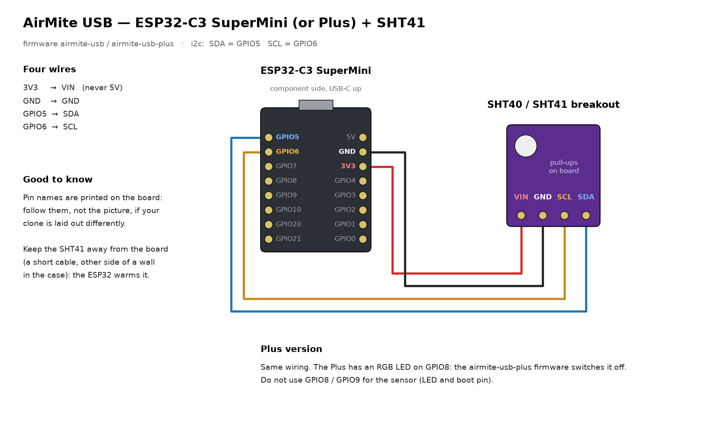
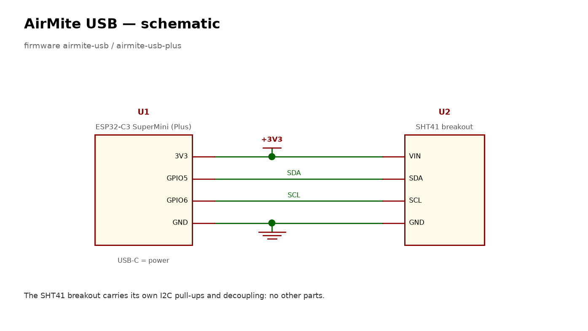
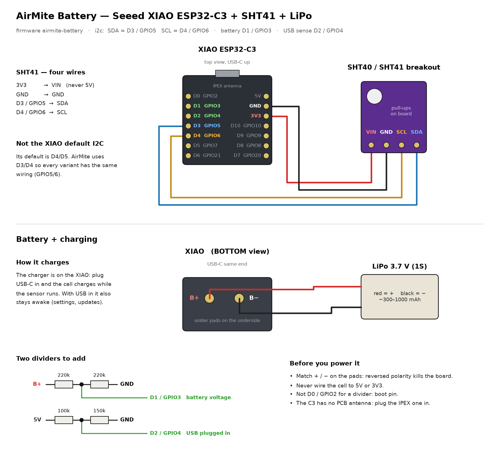
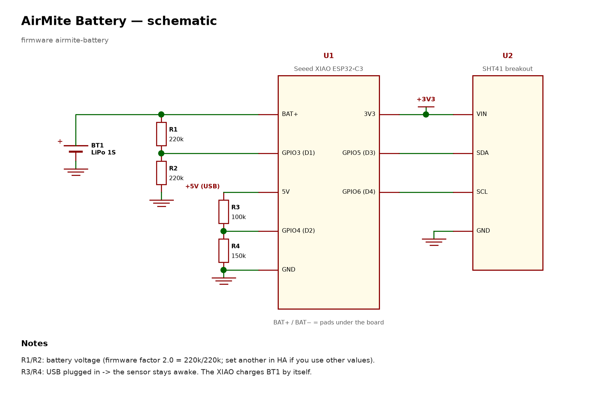

<h1 align="center">
  <picture>
    <source media="(prefers-color-scheme: dark)" srcset="docs/logo/airmite-wordmark-dark.svg">
    
  </picture>
</h1>

[](https://buymeacoffee.com/tlabcustom)

Tiny temperature + humidity sensors for **Home Assistant**, built on an ESP32-C3 and a
Sensirion SHT40/41 (or a Bosch BME280 outdoors, with pressure). You don't need to write any code or edit any files:

1. flash the firmware from the browser,
2. type in your Wi-Fi,
3. pick the room in Home Assistant,
4. set the calibration offsets from Home Assistant.

**Compatible with [CapillAir](https://github.com/tlabcustomaudio/CapillAir).** Every AirMite reports
temperature, relative humidity and **absolute humidity** (g/m³), the readings CapillAir uses to
compare each room with the outdoor air. Name the device after the room (step 3) and its entities
match: `sensor.<room>_temperature`, `sensor.<room>_absolute_humidity`.

## The variants

| | Board | Power | Firmware |
|---|---|---|---|
| **AirMite USB** | ESP32-C3 SuperMini | USB-C, always on, updates every 30 s | [airmite-usb.factory.bin](https://github.com/tlabcustomaudio/airmite/releases/latest/download/airmite-usb.factory.bin) |
| **AirMite USB Plus** | ESP32-C3 SuperMini **Plus** | USB-C, always on, updates every 30 s | [airmite-usb-plus.factory.bin](https://github.com/tlabcustomaudio/airmite/releases/latest/download/airmite-usb-plus.factory.bin) |
| **AirMite Outdoor** | ESP32-C3 SuperMini **Plus** + **BME280** | USB-C, always on, updates every 30 s, adds **Pressure** | [airmite-outdoor.factory.bin](https://github.com/tlabcustomaudio/airmite/releases/latest/download/airmite-outdoor.factory.bin) |
| **AirMite Battery** | Seeed Studio XIAO ESP32-C3 | 1S LiPo, wakes every 15 min (months per charge), charges from USB-C | [airmite-battery.factory.bin](https://github.com/tlabcustomaudio/airmite/releases/latest/download/airmite-battery.factory.bin) |

Every variant shows these entities in Home Assistant:
- **Temperature**, **Humidity**, **Absolute humidity**.
- **Temperature offset** and **Humidity offset** (settings).
- The outdoor variant also has **Pressure** (hPa).
- The battery variant also has **Battery** (%), **Battery Voltage**, **USB Power**, **Battery divider factor** and **Prevent Deep Sleep**. Turn Prevent Deep Sleep on to keep it awake for an update; turning it off sends it back to sleep.

Enclosures (3D-printable) are coming on MakerWorld; the link will be here.

## Parts

| Part | USB | Outdoor | Battery |
|---|---|---|---|
| ESP32-C3 board | SuperMini or SuperMini Plus | SuperMini Plus | Seeed XIAO ESP32-C3 (with its IPEX antenna) |
| SHT40 or SHT41 breakout (I2C, with pull-ups) | 1 | – | 1 |
| BME280 breakout (I2C, 3.3 V, address 0x76) | – | 1 | – |
| Radiation shield (Stevenson screen) | – | ✓ | – |
| LiPo 3.7 V 1S, ~300–1000 mAh | – | – | 1 |
| Resistors | – | – | 2× 220k, 1× 100k, 1× 150k |
| Wire, USB-C cable / power supply | ✓ | ✓ | ✓ (to charge) |

## Wiring

All variants use the same sensor wiring: **SDA → GPIO5**, **SCL → GPIO6**, **VIN → 3V3**
(never 5V), **GND → GND**.

### AirMite USB / USB Plus





### AirMite Outdoor

Same four wires as the USB picture, with a BME280 in place of the SHT41. Not GPIO8/9: on the
Plus, GPIO8 drives the RGB LED, and I2C traffic there lights it up and warms the sensor.
The firmware expects address 0x76 (most breakouts); a board with SDO tied high is 0x77.

### AirMite Battery





Besides the sensor, it needs:
- **R1/R2**, 220k + 220k, from BAT+ to GND, middle to **D1/GPIO3**: this measures the battery.
- **R3/R4**, 100k + 150k, from 5V to GND, middle to **D2/GPIO4**: this tells the board USB is plugged in. With USB plugged in it stays awake.

## 1. Flash the firmware

1. Download the `.factory.bin` for your board (table above, or [Releases](https://github.com/tlabcustomaudio/airmite/releases)).
2. Open **<https://web.esphome.io>** in Chrome or Edge and plug the board in by USB.
3. **Connect** → choose the port → **Install** → pick the file you downloaded.
4. When it's done, the page asks for your **Wi-Fi** name and password. Type them in.

If the board isn't detected, hold **BOOT** while plugging it in.

If you skipped the Wi-Fi step, or later change your Wi-Fi: when the sensor can't connect, it opens its own
**"AirMite setup"** hotspot. Join it from a phone and choose your network.

## 2. Add it to Home Assistant

You need the **ESPHome** integration; Home Assistant offers it by itself.

1. Go to **Settings → Devices & services**. The sensor appears under **Discovered** as *AirMite*.
2. Click **Add**, then choose the **room (area)**.
3. Open the device and rename it after the room with ✏️ (e.g. *Kitchen*). When Home Assistant asks
   whether to rename the entity IDs too, say **yes**. The entities become
   `sensor.kitchen_temperature` and so on; this is what CapillAir looks for.

To move the sensor to another room later: open the device → ✏️ → **Area**.

## 3. Calibrate

No sensor is perfect, and a board that is always on warms its own sensor a little. To correct it:

1. Put the AirMite next to a thermometer/hygrometer you trust for **about an hour**.
2. Open the device in Home Assistant. Under **Configuration**, set:
   - **Temperature offset** = reference − AirMite. AirMite 22.5 °C, reference 21.0 °C → **−1.5**.
   - **Humidity offset** = reference − AirMite. AirMite 52 %, reference 55 % → **+3**.

The sensor stores the offsets itself, so they survive reboots, power cuts and firmware updates.

**USB Plus** starts at −1.7 °C / +3.8 %, measured on one board. Check yours anyway.

**Outdoor:** calibrate it indoors next to the reference, before you mount it outside. The
humidity reading follows the temperature offset by itself (same water content at the corrected
temperature), so the humidity offset is only what is left after that.

**Battery:** the board is awake only a few seconds every 15 minutes. To change a setting, plug
USB in (it then stays awake), change it, and unplug.

**Battery divider factor:** leave it at 2.0 if you used 220k + 220k. To check it, charge the
cell full with USB plugged in; the cell is then at 4.20 V. If **Battery Voltage** shows something
else, set factor = old factor × 4.20 ÷ the reading.

## Updates

Firmware updates go over Wi-Fi. If you use the **ESPHome Device Builder** add-on, the discovered AirMite shows
**Take control**: it then compiles and updates it for you, with your own Wi-Fi in `secrets.yaml`.
Without it, flash the new `.factory.bin` over USB as in step 1. The stored offsets stay.

## Build it yourself

`firmware/` holds plain ESPHome configs. `common.yaml` is the shared part, `sht4x.yaml` / `bme280.yaml` the
sensor, and each board file adds only what is different:

```bash
esphome run firmware/airmite-usb.yaml
```

No `secrets.yaml` needed. `tools/drawings.py` redraws the pictures in `docs/` and `tools/logo.py`
the wordmark (matplotlib + fontTools).

Using AirMite for your own sensors with your own keys and fixed IPs: write a small config that
includes the variant as a package and adds `api: encryption`, an OTA password and `wifi: manual_ip`.
Set `name_add_mac_suffix: false` to keep a fixed hostname. Firmware substitutions you can set:
`name`, `friendly_name`, `t_offset`, `rh_offset` (starting offsets) and, on the battery variant,
`bat_factor`.

**Security note:** shared firmware cannot carry your keys, so the API has no encryption key and
OTA has no password. Anyone on your local network could read or reflash the sensor. If that
matters to you, add `api: encryption: key:` and an OTA password in your own copy.

## License

MIT. Made by [T Lab](https://github.com/tlabcustomaudio). The wordmark uses
[Outfit](https://fonts.google.com/specimen/Outfit) (SIL Open Font License), converted to outlines.

If AirMite saves you time, you can support it on [Buy Me a Coffee](https://buymeacoffee.com/tlabcustom).
